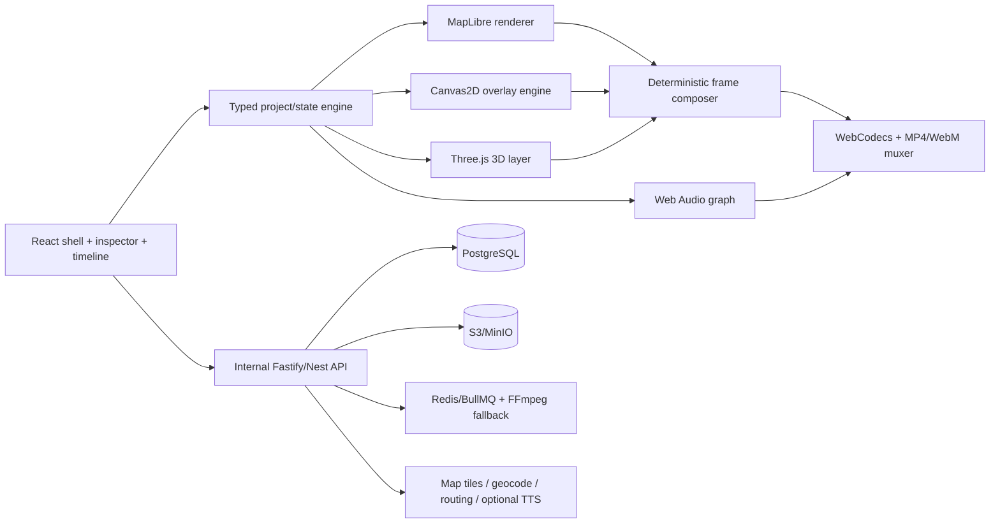

# Map Effect clone — Discovery & Roadmap

Ngày khảo sát: 2026-10-11 (Asia/Bangkok)  
Nguồn khảo sát: phiên đăng nhập hiện có tại `https://mapeffect.app/edit`  
Trạng thái workspace: trống, chưa khởi tạo source code.

## 1. Phạm vi và nguyên tắc

Mục tiêu là tái tạo trải nghiệm và hành vi quan sát được với độ tương đồng tối đa, nhưng theo hướng **clean-room implementation**: đo đạc giao diện/hành vi từ bên ngoài rồi tự viết lại. Không sao chép mã nguồn, asset thương mại, logo, dữ liệu riêng, khóa API hoặc nội dung có bản quyền nếu chưa có quyền sử dụng.

Trong dự án này, "100%" được hiểu là **đầy đủ các tính năng dựng video cốt lõi dùng nội bộ**, không phải clone toàn bộ mô hình SaaS/thương mại. Mức hoàn thiện sẽ được kiểm chứng bằng bộ tiêu chí có thể đo:

- Visual regression tại các viewport chuẩn, sai khác pixel/SSIM trong ngưỡng thống nhất.
- Feature parity theo ma trận thao tác, trạng thái, phím tắt, undo/redo và lỗi biên.
- Project JSON round-trip ổn định.
- Video xuất ra đúng kích thước, thời lượng, frame timing, audio sync và hiệu ứng.
- Hiệu năng tương đương trên cùng thiết bị/dự án mẫu.
- Responsive, accessibility và cross-browser theo ma trận được chốt.

Black-box discovery không thể chứng minh mọi trạng thái ẩn ngay lập tức. Phạm vi ưu tiên là editor, bản đồ, timeline, hiệu ứng và xuất video. Các bề mặt thanh toán/gói cước/referral/team không thuộc phạm vi.

### Phạm vi bắt buộc

- Tạo project, mở/lưu project nội bộ và autosave.
- Chế độ Map và Media; khung ngang 16:9, dọc 9:16 và vuông 1:1.
- Các lớp bản đồ, kiểu nền, màu/theme, zoom, xoay, nghiêng, góc nhìn 2D/3D.
- Tìm kiếm địa điểm, đặt điểm nhìn và điều khiển camera.
- Camera keyframe, nội suy chuyển động và preview đúng theo timeline.
- Khoanh vùng thủ công; khoanh vùng tự động theo địa danh khi dữ liệu cho phép.
- Vẽ đường thủ công; tạo tuyến đường tự động theo điểm A–B và phương tiện.
- Import KML/KMZ/GeoJSON.
- Các layer cơ bản: text, text effect, mũi tên, callout, icon/tiện ích, ảnh, video, audio và đối tượng chuyển động.
- Hiệu ứng vào/ra/chuyển động, thời tiết và các hiệu ứng hình ảnh cơ bản.
- Timeline/layer: chọn, kéo, đổi thời lượng, split, delete, visibility, snapping, zoom, marker, undo/redo.
- Snapshot PNG và xuất video MP4/WebM; trộn audio, theo dõi tiến trình, huỷ và thử lại.
- Ít nhất 720p và 1080p; ưu tiên thêm 1440p nếu thiết bị đáp ứng.
- Không watermark và không quota/gói cước vì chỉ chạy nội bộ.

### Phạm vi tuỳ chọn sau khi lõi ổn định

- Import/render mô hình 3D.
- Xoá nền ảnh/video.
- Tracking vật thể/planar tracking.
- Biểu đồ động, template nâng cao, animated icon library.
- Text-to-speech.
- Cloud sync nhiều máy; có thể thay bằng lưu file/local server ở bản đầu.

### Không thuộc phạm vi

- Trang giá, checkout, SePay, PayPal và quản lý giao dịch.
- Gói Free/Pro/Pro Max, quota xuất video, watermark theo gói.
- Affiliate/referral, ưu đãi và chiến dịch bán hàng.
- Team seat, mời thành viên và phân chia doanh thu.
- Clone nguyên trạng logo, thương hiệu hoặc asset thương mại không có quyền sử dụng.

## 2. Kết quả nhận diện công nghệ

### Frontend

- Custom HTML/CSS/JavaScript dạng ES modules; không thấy React, Vue, Angular, Next hoặc Nuxt ở runtime.
- Bundle có hash và chia chunk; tại trạng thái đã khảo sát có khoảng 2.53 MB JavaScript trong 39 file đã tải, bundle chính khoảng 558 KB. Không có source map công khai.
- Bản đồ: MapLibre GL JS `5.24.0`.
- Nguồn nền/tile quan sát được: OpenFreeMap, VersaTiles satellite và proxy/tile riêng của `mapeffect.app` cho một số mức zoom tại Việt Nam.
- Overlay/editor dùng nhiều Canvas 2D; bản đồ dùng WebGL. Có các module canvas riêng cho callout, location pin, title và text effects.
- Export phía trình duyệt có dấu hiệu dùng WebCodecs (`VideoEncoder`, `AudioEncoder`), MediaRecorder, `mp4-muxer` và `webm-muxer`.
- Bundle có dấu hiệu của Three.js/GLTF, Fabric, MediaPipe, GeoJSON và KML; cần kiểm thử từng luồng để xác nhận mức sử dụng thực tế.
- Google Identity Services cho đăng nhập; Google Analytics cho đo lường.
- Không có service worker điều khiển trang tại thời điểm khảo sát.

### Backend và API quan sát được

- Reverse proxy: nginx `1.24.0` trên Ubuntu.
- Nhóm API quan sát từ bundle/tài nguyên đã tải:
  - Auth/account: `/api/login`, `/api/auth/google`, `/api/me`, đăng ký/xác minh/khôi phục mật khẩu.
  - Project: `/api/projects`, `/api/mau-ca-nhan`, `/api/yeu-thich`.
  - Map: `/api/geocode`, `/api/route`.
  - Media/export: `/api/sfx`, `/api/tts`, `/api/export/authorize`, `/api/export/commit`.
  - Team: mời, nhận, huỷ, rời nhóm.
  - Billing: checkout, SePay và PayPal.
  - Config/marketing: config, ưu đãi, hit counter.
- Auth có dấu hiệu token được lưu cục bộ; không đọc hoặc lưu lại giá trị token trong báo cáo.

### Giao diện đo được ở viewport 1920 × 889

- Font chính: `Be Vietnam Pro`.
- Nền: `#0a0e17`; panel: `#0f1523`; panel cấp 2: `#131b2c`; panel cấp 3: `#182238`.
- Foreground: `#eef2fb`; muted: `#93a0bd`; accent: `#38bdf8`; accent phụ: `#c084fc`.
- Top bar cao 54 px; timeline cao 232 px; thanh công cụ trái rộng khoảng 166 px.
- Bố cục desktop: top bar; tool rail; inspector/work area; stage map; transport controls; timeline/layer lanes.
- Tỉ lệ khung hình: 16:9, 9:16, 1:1; chế độ Map và Media.

### Năng lực phần cứng/trình duyệt tại máy khảo sát

- Chrome 154, Windows 64-bit.
- 8 logical cores, 16 GB device memory báo bởi trình duyệt.
- GPU WebGL: NVIDIA Quadro P1000; max texture size 16384.
- WebCodecs, MediaRecorder, WebM VP9 và MP4 AVC được hỗ trợ.
- Trang hiện không chạy trong `crossOriginIsolated`, do đó kiến trúc hiện tại không phụ thuộc bắt buộc vào SharedArrayBuffer.

## 3. Bản đồ chức năng cấp cao

1. Shell/editor: ngôn ngữ, account/plan, phím tắt, new/save/open/cloud/export.
2. Workspace modes: Map/Media và ba aspect ratios.
3. Map: satellite/road, nhiều theme, 2D/3D, search, layer/view controls.
4. Drawing: selection, polygon, automatic boundary, manual route, automatic route, curated routes.
5. Import: KML/KMZ/GeoJSON, media và nhiều định dạng 3D.
6. Composition: text, animated text, arrows, callouts, amenities, objects, audio, weather, motion effects.
7. Advanced: charts, TTS, templates, animated icons, media segmentation/background removal, planar/object tracking.
8. Timeline: camera keyframes, markers, split, delete, layer visibility, snapping, zoom, duration, transport controls, undo/redo.
9. Project persistence: local JSON, cloud projects, autosave/state recovery.
10. Rendering/export: preview, snapshot PNG, video nhiều độ phân giải, không watermark/quota.
11. Cấu hình nội bộ: đường dẫn lưu trữ, provider bản đồ/geocode/route và tuỳ chọn render. Không cần billing hoặc plan entitlement.

## 4. Kiến trúc đề xuất



Khuyến nghị dùng TypeScript và React cho UI shell để dễ duy trì, nhưng giữ render engine/timeline/state tách khỏi React. Canvas/WebGL phải được điều khiển bằng clock xác định (deterministic), không dựa trực tiếp vào tốc độ `requestAnimationFrame`, để preview và export cho kết quả giống nhau.

## 5. Stack đề xuất

### Client

- TypeScript, Vite, React, Zustand hoặc Redux Toolkit.
- MapLibre GL JS; Turf.js; `@tmcw/togeojson` hoặc tương đương; JSZip.
- Canvas 2D + OffscreenCanvas; Three.js và loaders cần thiết.
- Web Audio API; WebCodecs; `mp4-muxer`/`webm-muxer` hoặc thư viện thay thế được duy trì.
- MediaPipe Tasks Vision cho segmentation/tracking; có fallback khi GPU/codec không đáp ứng.
- Zod cho schema project/version migration.

### Server

- Node.js 22 LTS, Fastify hoặc NestJS.
- PostgreSQL + Prisma/Drizzle.
- S3-compatible object storage (MinIO local, S3/R2 production).
- Redis + BullMQ cho job dài; FFmpeg/ffprobe cho probe/transcode/fallback render.
- Đăng nhập nội bộ là tuỳ chọn; routing/geocoding provider; TTS provider chỉ khi bật tính năng đọc chữ.
- Sentry + OpenTelemetry; structured logs.

### Test/QA

- Playwright cho E2E và visual snapshots.
- Vitest cho state engine, geometry, timing và schema migration.
- Pixelmatch/SSIM cho visual parity; ffprobe + frame extraction cho video parity.
- axe-core, Lighthouse, bundle analyzer.
- Test fixtures gồm project nhỏ/vừa/lớn, video dọc/ngang/vuông, dữ liệu KML/GeoJSON, audio và 3D.

## 6. Công cụ nên bổ sung

### Cần trước khi bắt đầu implementation

- **FFmpeg + ffprobe**: hiện đang thiếu; bắt buộc cho kiểm tra codec, audio sync, frame extraction và fallback render.
- **Node.js 22 LTS qua fnm/nvm-windows**: máy đang có Node 25.2.1; Node 22 ổn định hơn cho CI và native tooling.
- **pnpm cố định bằng Corepack**: hiện có pnpm nhưng nằm trong runtime fallback; nên pin `packageManager` trong `package.json`.
- **Playwright Chromium** và golden-image harness.
- **PostgreSQL + MinIO + Redis** qua Docker Compose cho môi trường local.

### Hữu ích nhưng không bắt buộc ngay

- Figma/plugin Figma để lưu design tokens và so sánh component nếu có file thiết kế.
- Sentry, OpenTelemetry collector, k6 cho tải và lỗi production.
- Storybook cho component states.
- Codex Security/plugin scan trước khi triển khai auth, upload và billing.
- GPU profiling qua Chrome Performance/WebGL tools.

### Đã có trên máy

- Git 2.51.2, Docker 29.8.0, Python 3.13.5, Node 25.2.1, npm 11.6.4, pnpm 11.25.0 và ripgrep.
- Bun chưa có nhưng không cần cho stack đề xuất.

## 7. Roadmap thực hiện

### Phase 0 — Quyền sử dụng và bộ chuẩn (2–4 ngày)

- Xác nhận quyền với logo, icon, template, SFX, font, map tile và dữ liệu premium.
- Chốt branding nội bộ và asset thay thế hợp pháp.
- Tạo ma trận browser/viewport/device và định nghĩa ngưỡng parity.
- Chuẩn bị 8–12 project mẫu và quay baseline hành vi/video.

**Gate:** danh mục asset có license + acceptance matrix được duyệt.

### Phase 1 — Black-box specification (1–2 tuần)

- Lập inventory tất cả dialog, tool, inspector field, menu, tooltip, keyboard shortcut và empty/error/loading state.
- Ghi state transition cho từng thao tác và network contract ở mức request/response shape không chứa bí mật.
- Đo CSS/layout ở desktop và responsive breakpoints.
- Chụp golden screenshots và golden exports.

**Gate:** mỗi feature có test case, dữ liệu vào, kết quả mong đợi và ảnh/video chuẩn.

### Phase 2 — Foundation + editor shell (1–2 tuần)

- Monorepo, CI, lint/typecheck/test, Docker Compose.
- Design tokens, top bar, tool rail, inspector, stage, timeline shell, responsive layouts.
- Typed project schema, command bus, undo/redo, autosave, migration.

**Gate:** visual parity shell + project save/load/undo/redo ổn định.

### Phase 3 — Map + geometry (2–3 tuần)

- MapLibre styles, 2D/3D camera, search/geocode, route.
- Polygon/line/boundary drawing, KML/KMZ/GeoJSON import.
- Camera keyframes và interpolation.

**Gate:** map interactions và geometry parity trên fixtures.

### Phase 4 — Timeline + composition engine (2–4 tuần)

- Layer model, selection/transform, timing, trimming, split, snapping, visibility.
- Text, arrow, callout, icon, object, media, audio và animation presets.
- Deterministic preview clock và renderer.

**Gate:** cùng project cho cùng frame output bất kể FPS màn hình.

### Phase 5 — Export pipeline (1–3 tuần)

- PNG snapshot, WebCodecs video encoder, MP4/WebM muxing, audio mixing.
- 720p/1080p/1440p, progress, cancel/retry, codec fallback; không watermark.
- FFmpeg verification và optional server fallback.

**Gate:** frame/time/audio parity và không rò rỉ bộ nhớ trên project dài.

### Phase 6 — Advanced media/3D/AI, tuỳ chọn (3–6 tuần)

- Three.js 3D import/render; object animation.
- Background removal, segmentation, object/planar tracking.
- Charts, templates, animated icons, TTS, weather effects.

**Gate:** từng tính năng có fixture và performance budget riêng.

### Phase 7 — Internal backend (1–2 tuần, có thể chạy song song)

- Local/internal projects, asset storage và optional user profile.
- Storage lifecycle, backup/restore và audit log tối thiểu.
- Không triển khai plans, billing, referral hoặc team seats.

**Gate:** security review, export reliability và recovery tests.

### Phase 8 — Parity closure + release (2–3 tuần)

- Chạy toàn bộ visual/E2E/video matrix và xử lý diff.
- Profiling CPU/GPU/RAM, upload limits, corrupted file cases.
- Accessibility, security, privacy, deployment, monitoring, runbook.

**Gate:** không còn P0/P1; parity report được ký duyệt.

## 8. Ước lượng thực tế

- Một người làm full-time: khoảng 3–5 tháng cho editor nội bộ cốt lõi và export ổn định; phần tracking/3D nâng cao tính riêng.
- Nhóm 2–3 người (frontend/render, map/media, QA/backend): khoảng 8–12 tuần cho phạm vi bắt buộc, rồi thêm vòng đóng sai khác.
- Vertical slice (map + timeline + text/shape/media + local save + 1080p export): khoảng 3–5 tuần với nhóm nhỏ.

Đây là ước lượng discovery, chưa phải cam kết. Sau Phase 1 có thể chốt estimate chính xác theo feature matrix.

## 9. Bước tiếp theo được đề xuất

1. Hoàn thành Phase 1 bằng cách khảo sát từng công cụ trong một project thử nghiệm riêng, tránh tác động dự án hiện tại.
2. Chốt clean-room asset policy và các provider thay thế.
3. Cài FFmpeg, pin Node 22/pnpm, tạo monorepo và bộ golden tests.
4. Xây vertical slice đầu tiên: MapLibre + camera keyframe + một overlay text + timeline + export MP4.
5. Chỉ mở rộng feature sau khi vertical slice vượt qua visual/video parity gate.

## 10. Phương án triển khai và repo mã nguồn mở

### Phương án A — Clean-room hoàn toàn

Tự xây editor shell, schema, timeline, map engine và export engine; chỉ dùng các thư viện nền ổn định.

- Ưu điểm: kiến trúc sạch, UI bám MapEffect dễ nhất, ít mã thừa và chủ động lâu dài.
- Nhược điểm: phải tự giải quyết nhiều lỗi khó về đồng hồ timeline, audio sync, WebCodecs và deterministic export.
- Ước lượng: 10–14 tuần với nhóm 2–3 người cho phạm vi bắt buộc.
- Phù hợp khi: yêu cầu bảo trì dài hạn quan trọng hơn tốc độ ra MVP.

### Phương án B — Fork một ứng dụng hoạt họa bản đồ

Ứng viên gần nhất là `topmonroe9/travel-animation` (MIT). Repo đã có MapLibre, OSRM, Nominatim, camera đi theo tuyến, terrain/3D, Canvas HUD và xuất MP4 bằng WebCodecs.

- Ưu điểm: nhanh nhất để có route animation và MP4 chạy được.
- Nhược điểm: repo mới, ít commit/người dùng, dùng JavaScript tĩnh và CDN; chưa có timeline nhiều track, camera keyframe thủ công, polygon editor, layer model hoặc project migration.
- Ước lượng: 4–7 tuần để có MVP thiên về tuyến đường; 8–12 tuần để tái cấu trúc thành editor tổng quát.
- Kết luận: dùng làm reference/prototype, không nên dùng nguyên trạng làm nền production.

`Fangyuan025/triptrail` (MIT) cũng có MapLibre, route nhiều phương tiện và deterministic MP4 export, nhưng phần lớn ứng dụng nằm trong một file lớn. Repo phù hợp để tham khảo thuật toán sea route, route reveal và warm tile cache hơn là làm codebase chính.

### Phương án C — Fork video editor rồi thêm bản đồ

Ứng viên tốt nhất là `S07K/cutaway` (MIT): React/TypeScript, timeline nhiều track, keyframe/easing, undo/redo, local project, PixiJS compositor, audio mixing và MP4/WebM export.

- Ưu điểm: giải quyết sẵn phần khó của NLE/timeline/export; kiến trúc engine tách khỏi React.
- Nhược điểm: repo còn trẻ; compositor PixiJS không thể tự động điều khiển MapLibre; UI khác MapEffect và cần thay đáng kể.
- Ước lượng: 7–11 tuần với nhóm 2–3 người.
- Kết luận: có thể fork nếu video/media quan trọng hơn bản đồ; với phạm vi hiện tại, chỉ nên tái sử dụng engine/package có chọn lọc.

`btpoe/vide-os` có timeline và export tốt nhưng thiếu license file rõ ràng tại thời điểm khảo sát, dùng SolidJS và đang pre-alpha; không đưa vào dependency cho tới khi license được xác nhận.

### Phương án D — Hybrid có chọn lọc — khuyến nghị

Tạo codebase riêng bằng React/TypeScript và một project schema thống nhất, sau đó tích hợp/adapt các khối sau:

| Khối | Nguồn đề xuất | Cách sử dụng |
|---|---|---|
| Bản đồ/camera | MapLibre GL JS + tham khảo `travel-animation` | Viết `map-engine` riêng; port có attribution các phần camera theo thời gian, chờ tile idle và frame capture |
| Vẽ vùng/đường | Terra Draw | Dùng adapter MapLibre; bổ sung style, snapping và command undo/redo của ứng dụng |
| Khoanh vùng tự động | Nominatim `polygon_geojson` | Proxy/cache nội bộ; có thể self-host khi tải cao |
| Tuyến đường | OSRM self-host | Driving/bike/walk theo profile; chuẩn hóa đầu ra về GeoJSON |
| Timeline/keyframe | Tham khảo/adapt các engine MIT của Cutaway | Giữ logic timing/keyframe thuần TypeScript, không bê nguyên UI |
| Preview/composition | MapLibre + Canvas 2D/OffscreenCanvas | Mọi frame là hàm thuần của thời gian; cùng một render graph cho preview và export |
| Video/audio export | Adapt export/audio patterns của Cutaway và `travel-animation` | WebCodecs + muxer ở client; FFmpeg làm kiểm chứng và fallback nội bộ |
| Map style | Style JSON riêng; dùng Maputnik như công cụ thiết kế | Không nhúng toàn bộ Maputnik vào editor phiên bản đầu |

Kiến trúc repository đề xuất:

```text
apps/editor
packages/project-schema
packages/timeline-engine
packages/map-engine
packages/composition-engine
packages/export-engine
services/geo-routing
```

Nguyên tắc tích hợp:

- Không merge nguyên lịch sử/codebase của các demo vào ứng dụng chính.
- Port theo module nhỏ, giữ copyright/license notice và lập `THIRD_PARTY_NOTICES.md`.
- Bọc từng repo qua interface nội bộ để có thể thay thế mà không đổi project format.
- Viết golden tests cho camera, route reveal, polygon, frame timestamp và audio trước khi mở rộng UI.
- Tự xây lại UI theo kết quả black-box discovery; không dùng asset/logo/thương hiệu của MapEffect.

Ước lượng phương án hybrid: 6–10 tuần với nhóm 2–3 người cho phạm vi bắt buộc; một người khoảng 12–18 tuần. Vertical slice đầu tiên có thể đạt trong 2–4 tuần nếu giới hạn ở MapLibre, route, polygon, camera keyframe, text overlay, local save và MP4 1080p.

### Quyết định đề xuất

Chọn **phương án D — Hybrid**. Dùng `travel-animation` như reference implementation cho luồng map-to-video; dùng các engine MIT của Cutaway cho timeline/export nếu sau spike chứng minh tách được; dùng trực tiếp MapLibre, Terra Draw và OSRM như dependency/service ổn định. Không fork MapEffect và không fork nguyên một video editor.

Trước khi khóa dependency, thực hiện spike 5 ngày:

1. Render một route MapLibre 15 giây với hai camera keyframe và một polygon.
2. Điều khiển toàn bộ frame từ timeline thuần TypeScript ở 30 fps.
3. Xuất MP4 1080p có audio; so khung preview với frame đã encode.
4. Lưu/mở project JSON và kiểm tra undo/redo.
5. Ghi lại phần code được port, license và benchmark RAM/GPU/thời gian export.

Nếu spike vượt gate, tiếp tục hybrid. Nếu engine Cutaway khó tách hoặc preview/export sai khác, giữ map engine và thay phần export bằng renderer nội bộ dùng Chromium + FFmpeg.
