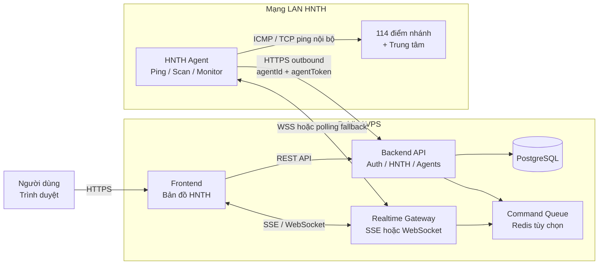
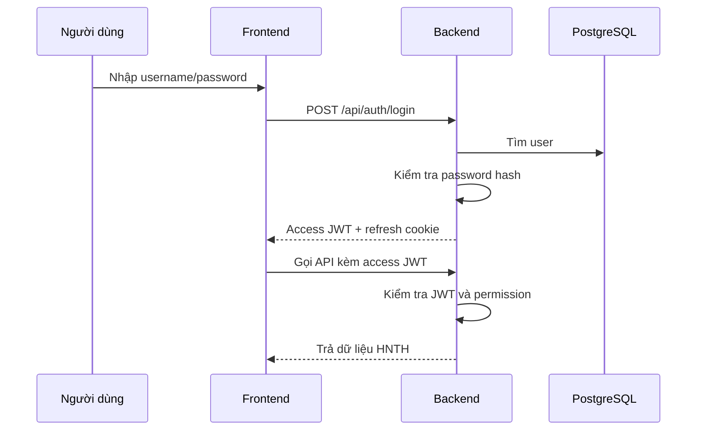
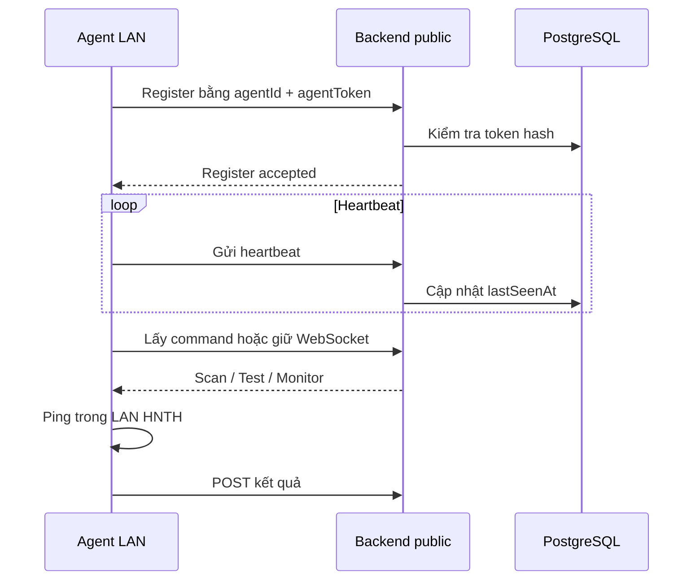

# Technote — Nâng cấp HNTH Map thành hệ thống Production

## 1. Mục tiêu

Nâng cấp hệ thống HNTH Map hiện tại từ mô hình Frontend + Relay tối giản thành hệ thống có Backend production đầy đủ, nhưng vẫn giữ nguyên trải nghiệm và giao diện bản đồ hiện tại.

Mục tiêu chính:

- Quản lý dữ liệu tập trung bằng PostgreSQL.
- Agent trong mạng LAN HNTH chủ động kết nối outbound đến Backend.
- Backend quản lý command, trạng thái endpoint, log và realtime event.
- Có đăng nhập người dùng và phân quyền.
- Có thể chạy hoàn chỉnh trên local trước khi triển khai lên VPS.
- Các module giao diện mới phải đồng bộ màu sắc, spacing, typography và component hiện tại.

## 2. Kiến trúc mục tiêu



## 3. Nguyên tắc phân chia trách nhiệm

### Frontend

Frontend chỉ chịu trách nhiệm:

- Hiển thị bản đồ và các lớp dữ liệu.
- Hiển thị popup, panel, log và trạng thái.
- Nhận thao tác người dùng.
- Gọi REST API.
- Nhận event realtime.
- Render màu nền, đường kết nối và trạng thái.

Frontend không phải nguồn dữ liệu chính và không tự quyết định trạng thái ping thật.

### Backend

Backend chịu trách nhiệm:

- Xác thực người dùng.
- Phân quyền API.
- Quản lý Agent và token Agent.
- Lưu cấu hình 115 endpoint.
- Quản lý command Scan/Test/Monitor.
- Lưu trạng thái endpoint.
- Lưu lịch sử monitor log.
- Phát event realtime.
- Ghi audit log.

### Agent

Agent chịu trách nhiệm:

- Chạy trong mạng LAN HNTH.
- Ping/scan thiết bị thật.
- Chia 115 endpoint thành các batch theo số luồng.
- Xử lý đầy đủ batch dư khi tổng endpoint không chia hết cho số luồng.
- Nhận IP/cấu hình mới từ Backend.
- Gửi kết quả khi trạng thái thay đổi.
- Gửi heartbeat.
- Tự reconnect khi mất kết nối.

## 4. Cấu trúc module Backend

```text
services/hnth-backend/
├── src/
│   ├── server.mjs
│   ├── config/
│   │   ├── env.mjs
│   │   └── constants.mjs
│   ├── middleware/
│   │   ├── auth.mjs
│   │   ├── permissions.mjs
│   │   ├── cors.mjs
│   │   └── error-handler.mjs
│   ├── routes/
│   │   ├── auth.mjs
│   │   ├── users.mjs
│   │   ├── agents.mjs
│   │   ├── endpoints.mjs
│   │   ├── commands.mjs
│   │   ├── monitoring.mjs
│   │   └── health.mjs
│   ├── services/
│   │   ├── auth-service.mjs
│   │   ├── agent-service.mjs
│   │   ├── command-service.mjs
│   │   ├── endpoint-service.mjs
│   │   ├── monitor-service.mjs
│   │   └── realtime-service.mjs
│   ├── repositories/
│   │   ├── user-repository.mjs
│   │   ├── agent-repository.mjs
│   │   ├── endpoint-repository.mjs
│   │   └── audit-repository.mjs
│   └── realtime/
│       ├── sse.mjs
│       └── websocket.mjs
├── migrations/
├── package.json
└── README.md
```

Relay hiện tại sẽ được chuyển dần thành Backend API, tránh viết lại toàn bộ trong một lần.

## 5. Database

Database chính: **PostgreSQL**.

Các bảng cần có:

```text
users
refresh_tokens
agents
endpoints
endpoint_configs
commands
ping_results
monitor_logs
audit_logs
```

PostgreSQL được chạy ngay từ môi trường local để tránh phải chuyển đổi database khi đưa lên VPS.

Redis chưa bắt buộc ở giai đoạn đầu. Chỉ bổ sung Redis khi cần command queue, pub/sub hoặc nhiều Agent.

## 6. Đăng nhập và phân quyền

### Người dùng

Dùng:

```text
Access token: JWT, thời hạn ngắn khoảng 15 phút
Refresh token: token dài hạn, lưu bằng HttpOnly cookie
```

Mật khẩu phải được băm bằng bcrypt hoặc Argon2id.

Không lưu access token trong `localStorage` khi chạy production.

### Agent

Agent dùng credential riêng:

```text
agentId
agentToken
```

Agent token không đưa vào frontend và nên được lưu dạng hash trong database để có thể thu hồi hoặc rotate.

### Role ban đầu

| Role | Quyền |
|---|---|
| `admin` | Quản lý user, Agent, endpoint và toàn bộ hệ thống |
| `operator` | Xem bản đồ, Scan, Test, Monitor, sửa cấu hình IP |
| `viewer` | Chỉ xem bản đồ, trạng thái và log |

Các permission chính:

```text
hnth:view
hnth:test
hnth:scan
hnth:monitor
hnth:edit-config
agents:manage
users:manage
audit:view
```

## 7. API chính

### Authentication

```text
POST /api/auth/login
POST /api/auth/refresh
POST /api/auth/logout
GET  /api/auth/me
```

### Users

```text
GET    /api/users
POST   /api/users
PUT    /api/users/:id
DELETE /api/users/:id
```

### Agents

```text
POST   /api/agents/register
GET    /api/agents
POST   /api/agents/:id/rotate-token
DELETE /api/agents/:id
POST   /api/agents/:id/heartbeat
```

### HNTH

```text
GET  /api/endpoints
PUT  /api/endpoints/:endpointId

POST /api/commands
GET  /api/agents/:agentId/commands
POST /api/agents/:agentId/results

GET  /api/monitor/status
GET  /api/monitor/logs
GET  /api/monitor/stream
```

## 8. Luồng xác thực người dùng



## 9. Luồng Agent outbound



## 10. Đồng bộ giao diện hiện tại

Các module mới phải tái sử dụng giao diện hiện tại, không tạo một design system riêng.

### Login

- Dùng nền, border, radius và typography đang có.
- Giữ cảm giác dashboard vận hành hiện tại.
- Dùng cùng component button, input, badge và panel.
- Không dùng giao diện login mặc định của thư viện khác.

### User management

- Hiển thị trong panel quản trị cùng phong cách với các panel hiện tại.
- Role hiển thị bằng badge cùng hệ màu trạng thái.
- Các thao tác nguy hiểm phải có confirm dialog cùng kiểu hiện có.

### Agent management

- Hiển thị Agent online/offline bằng màu trạng thái hiện tại.
- Có thời gian `lastSeenAt`, version và số endpoint đang phụ trách.
- Token chỉ hiển thị một lần khi tạo hoặc rotate.

### HNTH panel

- Giữ nguyên các nút Scan, Test, Monitor.
- Chỉ thay nguồn dữ liệu từ frontend state sang Backend API.
- Popup Log, đường kết nối và màu nền giữ nguyên cách hiển thị.

## 11. Roadmap triển khai local

### Phase 1 — Chuẩn hóa nền tảng

- [ ] Tạo package `hnth-backend`.
- [ ] Chuyển Relay thành module route/service/repository.
- [ ] Thêm biến môi trường local.
- [ ] Chuẩn hóa 115 endpoint và endpointId.
- [ ] Thêm health check.

### Phase 2 — PostgreSQL

- [ ] Thêm PostgreSQL bằng Docker Compose.
- [ ] Tạo migration cho users, agents, endpoints, commands, logs.
- [ ] Seed 115 endpoint.
- [ ] Seed tài khoản admin local.
- [ ] Viết repository và transaction cơ bản.

### Phase 3 — Authentication/RBAC

- [ ] Tạo login page.
- [ ] Thêm JWT access token.
- [ ] Thêm refresh token HttpOnly cookie.
- [ ] Thêm middleware xác thực.
- [ ] Thêm middleware kiểm tra role/permission.
- [ ] Bảo vệ API HNTH.
- [ ] Thêm logout và rotate refresh token.

### Phase 4 — Agent registry

- [ ] Agent register bằng agentId/token.
- [ ] Lưu token hash.
- [ ] Heartbeat.
- [ ] Rotate/revoke token.
- [ ] Tự reconnect.
- [ ] Nhận IP/cấu hình mới.

### Phase 5 — Monitoring production

- [ ] Backend quản lý monitor session.
- [ ] Agent xử lý batch 115 endpoint.
- [ ] Đảm bảo xử lý batch dư.
- [ ] Lưu trạng thái `unknown`, `offline`, `waiting`, `connected`.
- [ ] Chỉ gửi event khi trạng thái thay đổi.
- [ ] Lưu monitor log.

### Phase 6 — Realtime

- [ ] SSE hoặc WebSocket cho frontend.
- [ ] Reconnect tự động.
- [ ] Snapshot sau reconnect.
- [ ] Chống event trùng.
- [ ] Giữ log theo thứ tự thời gian.

### Phase 7 — Kiểm thử local

- [ ] Restart Backend không mất dữ liệu.
- [ ] Restart Agent tự đăng ký lại.
- [ ] Mất mạng và reconnect.
- [ ] Đổi IP trên frontend và Agent nhận IP mới.
- [ ] Đổi số luồng khi đang monitor.
- [ ] Kiểm tra đủ 115 endpoint.
- [ ] Kiểm tra quyền admin/operator/viewer.
- [ ] Kiểm tra token sai và token bị thu hồi.
- [ ] Nhiều trình duyệt cùng xem dữ liệu.

## 12. Đóng gói local

Mục tiêu chạy local:

```text
Frontend:  http://127.0.0.1:3000
Backend:   http://127.0.0.1:8787
Postgres:  localhost:5432
Agent:     chạy trên máy trong LAN HNTH
```

Lệnh dự kiến:

```powershell
pnpm db:up
pnpm dev:backend
pnpm dev:frontend
pnpm dev:agent
```

Có thể thêm lệnh chạy đồng thời sau khi các package đã ổn định:

```powershell
pnpm dev
```

## 13. Triển khai VPS sau khi local ổn định

```text
Nginx/Caddy + HTTPS
Frontend build
Backend API
PostgreSQL
Redis tùy chọn
Agent trong LAN HNTH
```

Các việc cần làm:

- Trỏ domain frontend và API.
- Cấu hình HTTPS.
- Đổi JWT secret.
- Đổi mật khẩu admin.
- Cấu hình CORS chỉ cho domain frontend.
- Backup PostgreSQL.
- Thiết lập restart tự động.
- Thiết lập health check và log.
- Cài Agent trong mạng LAN HNTH.

## 14. Tiêu chí hoàn thành

Hệ thống được xem là đạt phiên bản production-ready đầu tiên khi:

- Người dùng đăng nhập được.
- API kiểm tra đúng quyền.
- Agent đăng ký bằng token riêng.
- Frontend không chứa Agent token.
- Cấu hình IP được lưu trong PostgreSQL.
- Agent nhận được IP mới sau khi thay đổi.
- Monitoring quét đủ 115 endpoint.
- Không bỏ qua batch dư.
- Frontend nhận trạng thái realtime.
- Log không bị mất hoặc lặp khi reconnect.
- Restart Backend/Agent không làm mất dữ liệu.
- Có audit log cho các thao tác cấu hình và quản trị.

## 15. Quyết định kỹ thuật chính

```text
Database       PostgreSQL
Cache/queue    Redis, bổ sung khi cần
User auth      JWT access token + refresh token HttpOnly
Agent auth     agentId + opaque agent token có thể revoke
Realtime       SSE trước, WebSocket khi cần hai chiều
Frontend       Giữ giao diện hiện tại, thay nguồn dữ liệu qua API
Agent          Chủ động outbound, không mở inbound port trong LAN
Triển khai     Local trước, VPS sau
```
